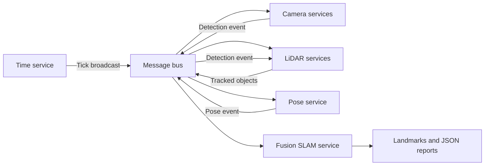

# Robot Perception & Mapping

[](https://github.com/Idoco24/robot-perception-mapping/actions/workflows/ci.yml)

A multithreaded Java simulation of a robot perception pipeline. Camera detections
are matched with LiDAR point clouds, transformed using GPS/IMU poses and fused into
a landmark map. Sensor workers communicate through an in-process message bus.

The simulation uses JSON sensor recordings and runs locally without robot hardware.

## What it demonstrates

- Concurrent services, per-service blocking queues and callback-based processing.
- Round-robin event delivery, broadcasts and future-based results.
- Object-oriented sensor models and a layered perception pipeline.
- Local-to-global 2D coordinate transforms and landmark coordinate updates.
- Normal shutdown and diagnostic output when a sensor reports an error.
- Maven builds, JUnit tests and automated GitHub Actions checks.

## Architecture



Each service has its own thread and message queue. `MessageBusImpl` routes events
to one subscriber and broadcasts to all subscribers. `FusionSlam` converts cloud
points into world coordinates using the pose's translation and yaw, and updates
existing landmarks by ID. These are local Java services, not separately deployed
network microservices.

## Requirements

- **JDK 21** (the code uses Java 21 collection APIs).
- **Maven 3.9 or later**.

Check both `java -version` and `mvn -version`: Maven must also use JDK 21 or later.
The first build needs an internet connection to retrieve Maven dependencies.
GNU Make is optional.

## Build and test

From the repository root:

```sh
mvn --batch-mode --no-transfer-progress verify
```

This compiles the code, runs **17 tests**, including two process-level simulation
checks, and creates `target/spl225ass2-1.0.jar`. The JAR does not bundle Gson;
use the Maven execution commands below to supply the runtime classpath.

```sh
mvn test
```

Tests cover cameras, message-bus registration/delivery/completion, future timeouts,
multi-point coordinate transforms, averaging, CLI arguments and both output paths.
The integration tests launch fresh JVMs to isolate singleton state and allow
20 seconds per simulation. A full test run normally takes about 20-40 seconds.

## Run the small normal demo

```sh
mvn compile exec:java "-Dexec.args=examples/normal/configuration.json"
```

The synthetic demo has one camera, one LiDAR worker, stationary poses and one wall
with two cloud points. It finishes after several one-second ticks and writes
`out.json` into the **current working directory**. The output includes:

```json
{
  "numLandmarks": 1,
  "landMarks": {
    "wall": {
      "id": "wall",
      "description": "Synthetic demo wall",
      "coordinates": [{ "x": 1.0, "y": 0.0 }, { "x": 0.0, "y": 2.0 }]
    }
  }
}
```

This excerpt omits runtime and object counters. Scheduling can affect timing and
message ordering; it is not intended as a bit-for-bit output fixture.

## Run the sensor-failure demo

```sh
mvn compile exec:java "-Dexec.args=examples/sensor-failure/configuration_file.json"
```

The sensor-failure input includes a deliberate `ERROR` detection from `camera1`.
The system stops and writes **`error_output.json`**, containing the faulty sensor,
recent camera/LiDAR frames, poses and statistics. An error report is the expected
result for this dataset; it is not the normal demo. A handled sensor failure can
exit successfully at the process level.

Generated reports are ignored by Git. Each run is intended to use a fresh JVM;
singleton state is not reset to support repeated runs inside the same JVM.
Both report types use fixed filenames and overwrite the corresponding prior file.
Remove stale reports or use an empty working directory when comparing runs.

Optional GNU Make commands: `make compile`, `make test`, `make run`, or
`make run CONFIG_FILE=examples/normal/configuration.json`.

## Input format

The configuration selects camera/LiDAR IDs and their processing frequencies,
data paths, `TickTime` (seconds per simulation tick) and `Duration` (tick count).
Both timing values must be positive. Sensor paths are resolved relative to the
configuration file, so the data can travel together as a folder.

| File | Contents |
| --- | --- |
| Camera data | Map from camera keys to timestamped object IDs/descriptions |
| LiDAR data | Timestamped object IDs and arrays of `[x, y]` points |
| Pose data | Array of `time`, `x`, `y` and `yaw` records; yaw is in degrees |

`examples/sensor-failure/` contains the diagnostic scenario. `examples/normal/`
contains the small synthetic success case. Expected schemas can be read directly
from those JSON files; not all malformed inputs have explicit validation yet.

## Repository layout

```text
src/main/java/bgu/spl/mics/
  MessageBusImpl.java, MicroService.java, Future.java
  application/configuration/   JSON configuration models
  application/messages/        Events and broadcasts
  application/objects/         Sensor, pose and landmark models
  application/services/        Camera, LiDAR, pose, fusion and clock services
  application/GurionRockRunner.java
src/test/java/bgu/spl/mics/     Unit and process-level integration tests
examples/normal/               Small synthetic demo inputs
examples/sensor-failure/       Sensor-failure diagnostic inputs
docs/VALIDATION.md             Verification evidence and remaining limitations
.github/workflows/ci.yml       JDK 21 build and tests
```

## Limitations

Service startup and pose ordering can depend on thread scheduling. Components use
singleton state; start a fresh JVM for each run. Input validation is partial, and
passing tests does not establish deterministic behavior under every workload.
See [validation notes](docs/VALIDATION.md) for coverage and remaining limits.
